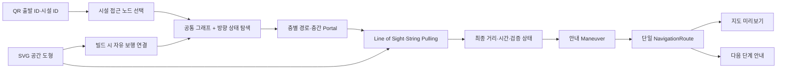

# 대전역 내비게이션 아키텍처

## 흐름

`scripts/build-spatial-data.py`는 디자인 SVG의 바닥·시설 Polygon을 추출한다. `build-navigation-data.py`는 기존 계산 그래프를 보존한 채 교차점 분리 결과를 별도 JSON으로 생성한다. `build-local-links.py`는 Shapely를 빌드 단계에만 사용해 3 SVG 단위 여유를 가진 직선 가시 연결을 만든다. 브라우저 번들에는 Shapely가 들어가지 않는다. 변경 이력과 원본 SHA-256은 생성 그래프에 기록된다.

`src/lib/station/navigation.ts`는 층간 링크의 방향을 보존하고, 이동 모드에 따라 계단·에스컬레이터를 필터링한다. `SHORTEST`는 이동 거리, `SIMPLE`은 거리와 회전 3m·분기점 2m·층간 이동 2m 환산 비용을 사용한다. `SIMPLE`은 최단 경로보다 10% 이상 길거나 회전·노드 복잡도를 줄이지 못하면 선택되지 않는다. 동일 노드의 진입 간선별 탐색 상태를 분리한다. 출발점·모드·전략·그래프 버전별 탐색 트리를 최대 8개 캐시한다.

`spatial.ts`는 전체 선분의 보행 윤곽·차단 도형 침범을 검사한다. `geometry.ts`는 유효한 같은 층 선만 String Pulling하고 최종 선을 다시 검사한다. 층간 Portal은 단순화 경계로 유지한다. `instructions.ts`는 최종 선에서 실제 회전과 층간 이동 단계를 만들고, `steps.ts`는 기존 Figma 안내 카드 형식으로 표현한다. `useJourney.ts`는 출발·목적지·플랫폼이 바뀔 때만 계획을 재생성하고 다음 버튼은 단계 인덱스만 바꾼다.

`/navigation-debug`는 개발 환경에서만 페이지를 제공하며 프로덕션에서는 404를 반환한다. 원본·개선 Edge, 공간 도형, 최단·간단·Grid 경로, 검증 경고를 겹쳐 볼 수 있고 현재 검증 결과를 JSON으로 내보낼 수 있다. `gridAudit.ts`의 8방향 A*는 독립 비교기이며 운영 경로 선택에 사용하지 않는다.

현재 사용자 화면의 POI 목록은 기존 3층 59시설이다. 1·2·4층 엔진 경로는 노드 기준으로 사용할 수 있으나, 현장 검증된 해당 층 시설 입구 자료가 없어 운영 화면의 목적지 목록으로 승격하지 않는다.
